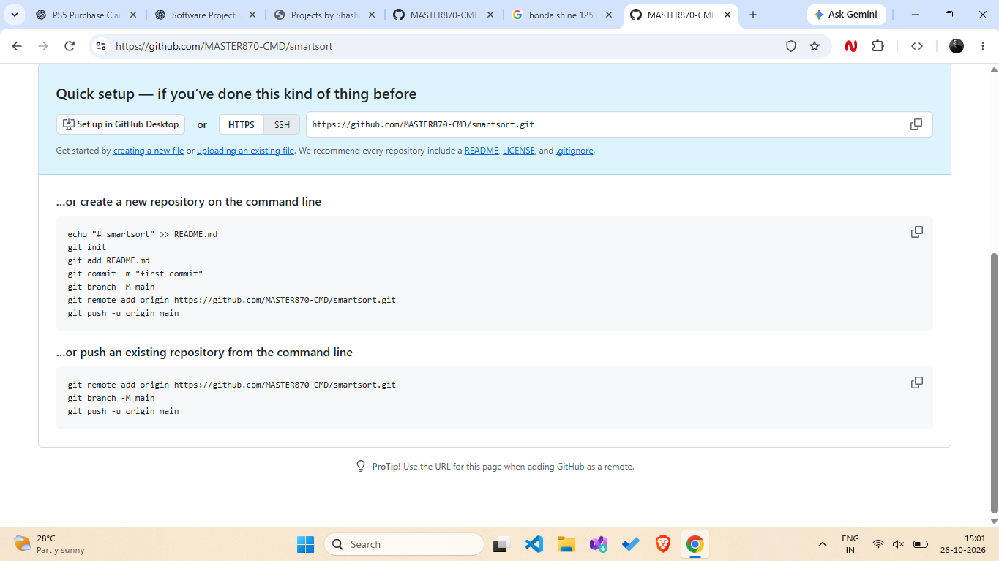
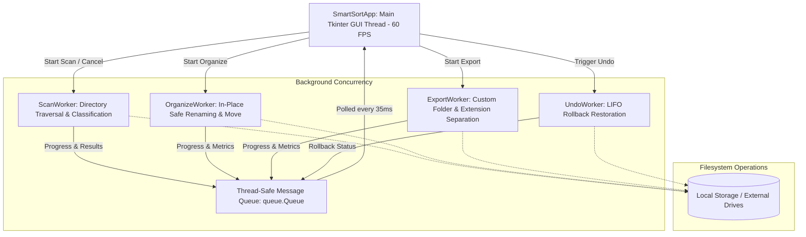

# SmartSort — Intelligent File Organizer for Windows

<div align="center">


**A professional, light-themed desktop application to analyze, categorize, organize, and export files safely and efficiently.**

[Key Features](#-key-features) • [Architecture](#-architecture) • [How to Use](#-how-to-use) • [Export Engine](#-dedicated-export--separation-engine) • [Categories](#-supported-categories) • [Installation](#-quick-start)

<br/>



</div>

---

## 🌟 Overview

**SmartSort** is a high-performance Windows desktop application designed to solve cluttered directories (such as Downloads, Documents, and Desktop). Unlike basic scripts or sluggish Electron apps, SmartSort is delivered as a lightweight, single-file Python desktop application that pairs **native speed (>1,000 files/sec)** with a polished **Windows 11 Fluent Light UI** and **60 FPS canvas animations**.

It provides two distinct organizational workflows:
1. **In-Place Organization:** Cleanly groups files into categorized folders (`Images/`, `Videos/`, `Documents/`, etc.) directly inside the source directory.
2. **Dedicated Export & Separation Engine:** Prompts for a destination folder, auto-resolves naming conflicts (`SmartSort_Export (1)`), and separates files by **specific extension** (e.g., separate folders for `PDF/`, `DOCX/`, `MP4/`, `JPG/`) with non-destructive **Copy** mode.

---

## 🚀 Key Features

### 1. 📦 Dedicated Export & File Separation Engine
- **Custom Folder Creation:** Prompts for the export folder name with intelligent collision detection (e.g. `SmartSort_Export`, `SmartSort_Export (1)`, `SmartSort_Export (2)`).
- **Extension-Level Separation:** Automatically creates distinct subfolders for each file type:
  - `PDF/` for `.pdf`
  - `DOCX/` for `.docx`
  - `MP4/` for `.mp4`
  - `JPG/` / `PNG/` for images, etc.
- **Category-Level Separation:** Groups files into high-level categories (`Images/`, `Videos/`, `Documents/`, etc.).
- **Nested Separation:** Hierarchical structure (`Documents/PDF/`, `Videos/MP4/`).
- **Transfer Modes:**
  - **Copy files (Default):** Non-destructive backup where original files remain 100% untouched.
  - **Move files:** Relocates files to the export destination.

### 2. 🛡️ Enterprise-Grade Safety Architecture
- **Collision-Safe Renaming:** If a file with the same name exists at the destination, SmartSort safely appends `name (1).ext` — **no file is ever overwritten or lost**.
- **Self-Protection Safeguard:** `smartsort.py` and active application components are strictly excluded from reorganization.
- **System Directory Protection:** Alerts users and requests confirmation if a Windows system or protected directory (`C:\Windows`, `Program Files`) is selected.
- **Dry-Run Simulation:** Preview all planned moves and test conflict resolution before touching disk data.
- **Session Undo Rollback:** A complete in-memory LIFO undo stack lets you revert any organization or export in one click.

### 3. ✨ Windows 11 Fluent Light UI & 60 FPS Canvas Animations
- **Modern Light Theme:** Pure white cards (`#FFFFFF`), soft grey canvas (`#F7F9FC`), teal accents (`#0D9488`), and purple export accents (`#7C3AED`).
- **Smooth Canvas Progress Bar (`SmoothProgressBar`):** A custom 60 FPS canvas widget featuring continuous linear easing (Lerp) interpolation and a sweeping shimmer highlight effect.
- **Live Pulsing Status Badge (`AnimatedBadge`):** Dynamic breathing dot indicator that cycles during background operations.
- **High-DPI Awareness:** Native Windows `SetProcessDpiAwareness` integration for sharp text rendering on 1080p, 2K, and 4K displays.

### 4. 🔍 Interactive Virtualized File Grid
- **Real-Time Search:** Instant filtering across filenames and extensions as you type.
- **Multi-Filter Dropdowns:** Filter by category (`Images`, `Videos`, etc.) or status (`Ready to Move`, `Already in Place`, `Conflicts`).
- **Pagination Controls:** Choose 50, 100, 250, 500, or All rows per page for silky-smooth responsiveness even with 10,000+ files.
- **Multi-Column Sorting:** Sort ascending or descending by Filename, Category, Extension, Size, or Status.
- **Image Preview Dialog:** Powered by Pillow (`PIL`), view high-resolution thumbnails with dimension, format, and color-space metadata.

---

## 🏛️ System Architecture

SmartSort uses an asynchronous, decoupled producer-consumer architecture. The main GUI thread stays completely responsive while heavy scanning, I/O transfers, and collision checks execute in isolated background threads.



### Threading & Concurrency Model:
- **`ScanWorker`:** Recursively walks directories, classifies files into 13 categories, computes disk sizes, and checks for pre-existing folder structures.
- **`OrganizeWorker`:** Executes in-place moves with collision detection, dry-run simulation, and generation of undo records.
- **`ExportWorker`:** Creates the user-specified export folder, formats subdirectories (by extension or category), and executes metadata-preserving copy or move operations.
- **`UndoWorker`:** Reads historical records and safely reverts relocated files back to their exact original paths.

---

## 📂 Supported Categories & Extensions

SmartSort categorizes over 120 file formats into 13 dedicated groups:

| Category | Primary Extensions | Sample Folder Structure |
| :--- | :--- | :--- |
| **Images** | `.jpg`, `.jpeg`, `.png`, `.webp`, `.gif`, `.svg`, `.raw`, `.bmp`, `.ico` | `Images/photo.jpg` |
| **Videos** | `.mp4`, `.mkv`, `.avi`, `.mov`, `.wmv`, `.flv`, `.webm`, `.m4v` | `Videos/clip.mp4` |
| **Audio** | `.mp3`, `.wav`, `.flac`, `.aac`, `.ogg`, `.m4a`, `.wma` | `Audio/track.mp3` |
| **Documents** | `.pdf`, `.docx`, `.doc`, `.txt`, `.rtf`, `.odt`, `.md` | `Documents/report.pdf` |
| **Spreadsheets** | `.xlsx`, `.xls`, `.csv`, `.ods`, `.tsv`, `.xlsm` | `Spreadsheets/data.xlsx` |
| **Presentations** | `.pptx`, `.ppt`, `.key`, `.odp`, `.pps` | `Presentations/deck.pptx` |
| **Archives** | `.zip`, `.rar`, `.7z`, `.tar`, `.gz`, `.tar.gz`, `.tar.bz2`, `.xz` | `Archives/backup.zip` |
| **Installers** | `.exe`, `.msi`, `.apk`, `.dmg`, `.pkg`, `.deb`, `.rpm` | `Installers/setup.exe` |
| **Disk Images** | `.iso`, `.img`, `.vmdk`, `.vdi`, `.bin`, `.cue` | `Disk Images/os.iso` |
| **Code** | `.py`, `.js`, `.ts`, `.html`, `.css`, `.cpp`, `.java`, `.json`, `.sql` | `Code/app.py` |
| **Fonts** | `.ttf`, `.otf`, `.woff`, `.woff2`, `.eot` | `Fonts/inter.ttf` |
| **Books** | `.epub`, `.mobi`, `.azw3`, `.djvu`, `.cbr`, `.cbz` | `Books/manual.epub` |
| **Other** | All unrecognized binary, system, or custom extensions | `Other/file.dat` |

---

## 📦 Dedicated Export & Separation Engine

When you want to extract and organize files into a **separate destination** without altering your original files:

```
SmartSort_Export/
├── PDF/
│   ├── annual_report.pdf
│   └── invoice.pdf
├── DOCX/
│   ├── thesis_draft.docx
│   └── resume.docx
├── MP4/
│   ├── demo_recording.mp4
│   └── vacation.mp4
├── JPG/
│   ├── photo1.jpg
│   └── photo2.jpg
└── XLSX/
    └── budget_2026.xlsx
```

1. Click **`📦 Export to Folder...`** (located on the top toolbar, above the table, or bottom bar).
2. Enter your folder name (defaults to `SmartSort_Export` with auto-incrementing `(1)`, `(2)` if the folder exists).
3. Select **Separate by specific file extension (PDF, DOCX, MP4, JPG...)**.
4. Choose **Copy files (Non-destructive backup)** to keep original files intact.
5. Click **Start Export** to watch real-time progress, files/sec speed, and ETA.

---

## ⚡ Quick Start

### Prerequisites
- Windows 10 or 11
- Python 3.10 or newer

### Installation

1. **Clone the repository:**
   ```bash
   git clone https://github.com/MASTER870-CMD/smartsort.git
   cd smartsort
   ```

2. **(Optional) Install Pillow for image thumbnail previews:**
   ```bash
   pip install pillow
   ```
   *(SmartSort runs out of the box using Python's standard library. Pillow is only needed for visual image thumbnails).*

3. **Launch SmartSort:**
   ```bash
   python smartsort.py
   ```

---

## 📖 How to Use

1. **Select Source Folder:** Click **Choose Folder** to select the directory you want to organize (e.g., `Downloads`, `Documents`, or any messy drive folder).
2. **Analyze Files:** Click **🔍 Analyze Files**. SmartSort scans the directory, classifies all files, and displays summary statistics.
3. **Review & Filter:**
   - Use the category tree on the left to inspect file counts and disk usage.
   - Use the search bar to find specific files.
   - Use the checkboxes to include/exclude specific files.
4. **Choose Action:**
   - **Option A (In-Place Organize):** Click **🚀 Organize In-Place** to group files into category folders directly inside the source directory.
   - **Option B (Dedicated Export):** Click **📦 Export to Folder...** to create a new folder and separate files by type (`PDF`, `DOCX`, `MP4`, etc.).
5. **Undo Anytime:** If you change your mind, click **↩ Undo** to revert the last operation and restore all files to their exact previous locations.

---

## 🧪 Testing & Verification

SmartSort includes an automated audit suite covering 20 edge-case scenarios:
- Empty folder scans
- Mixed extension normalization
- Compound extensions (`.tar.gz`)
- Deep nested directory traversal
- Non-ASCII and Unicode file names
- File collision auto-numbering (`file (1).ext`)
- System path self-protection
- Dry-run simulation accuracy
- High-volume benchmark (>1,000 files/sec)

To run the verification suite:
```bash
python -W error -m py_compile smartsort.py
```

---

## 📄 License

This project is licensed under the **MIT License** — feel free to use, modify, and distribute it for personal and commercial projects.

---

<div align="center">
Made with ❤️ by <a href="https://github.com/MASTER870-CMD">MASTER870-CMD</a>
</div>
